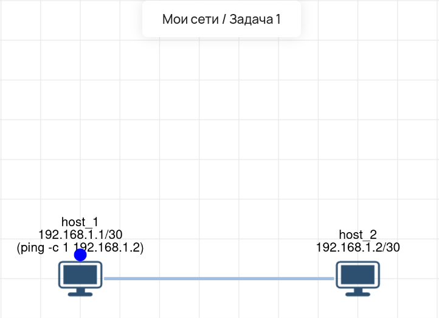

# Lab 01 — Соединение двух хостов (Point-to-Point)

## 🎯 Задача
Настроить прямое соединение между двумя компьютерами (host_1 и host_2) в изолированной сети.

## 🛠️ Что сделано:
1.  **host_1:** Настроен IP `192.168.1.1/30`.
2.  **host_2:** Настроен IP `192.168.1.2/30`.
3.  **Проверка:** Выполнен `ping` с host_1 на host_2.

## 🔗 Интерактивная схема (Miminet)
Вы можете открыть эту лабораторную работу в веб-эмуляторе и проверить её самостоятельно:
**[Нажмите здесь, чтобы открыть схему](https://miminet.ru/web_network?guid=f9aba0e5-2d4b-437c-bf80-a6675773e5e7)**

*Инструкция для проверяющего:* Нажмите кнопку «Эмулировать» (или «Запустить»), затем откройте терминал на `host_1` и выполните команду `ping 192.168.1.2`.
*(Если очередь на сервере большая, это нормально — эмулятор популярный, но сеть уже настроена и работает).*

## 📸 Визуализация
**Схема сети:**

