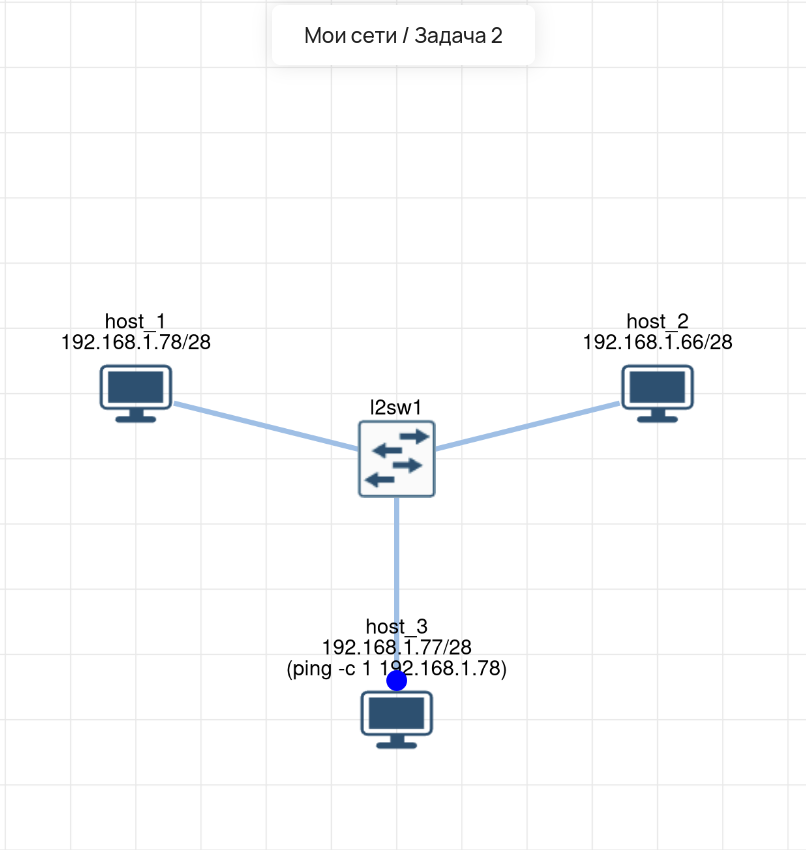

# Lab 02 — Подсеть /28 (3 хоста + коммутатор)

## 🎯 Задача
Настроить сеть из трех хостов и коммутатора. Использовать маску `/28`, чтобы понять, как ограничивается количество адресов в подсети. Проверить связность между `host_3` и `host_1`.

## 🛠️ Что сделано:
1.  **host_1:** Настроен IP `192.168.1.78/28`.
2.  **host_2:** Настроен IP `192.168.1.66/28`.
3.  **host_3:** Настроен IP `192.168.1.77/28` (в той же подсети, что и host_1).
4.  **Проверка:** Выполнен `ping` с host_3 на host_1. Связь есть, так как оба адреса входят в подсеть `/28` (диапазон 1–14).

## 🔗 Интерактивная схема (Miminet)
[Открыть схему в Miminet](https://miminet.ru/web_network?guid=9d999f8f-f7f8-4c54-bb73-e0bbebd2afb1)

## 📸 Визуализация

**Схема сети (3 хоста + коммутатор, маска /28):**

