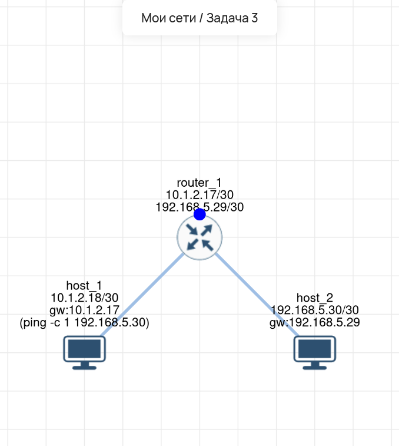

# Lab 03 — Маршрутизация между двумя подсетями (/30)

## 🎯 Задача
Настроить сеть из двух хостов и одного маршрутизатора. Хосты находятся в разных подсетях (`10.1.2.16/30` и `192.168.5.28/30`). Настроить маршрутизацию так, чтобы `host_1` мог пинговать `host_2`.

## 🛠️ Что сделано:
1.  **host_1:** IP `10.1.2.18/30`, шлюз `10.1.2.17`.
2.  **host_2:** IP `192.168.5.30/30`, шлюз `192.168.5.29`.
3.  **router_1:** Настроен с двумя интерфейсами: `10.1.2.17/30` и `192.168.5.29/30` (действует как шлюз).
4.  **Проверка:** Выполнен `ping -c 1 192.168.5.30` с `host_1`. Пакет проходит через роутер.

## 🔗 Интерактивная схема (Miminet)
Вы можете открыть эту лабораторную работу в веб-эмуляторе и проверить её самостоятельно, выполнив пинг с `host_1`:

**[Открыть схему в Miminet](https://miminet.ru/web_network?guid=886ae03f-38d7-4dd0-b963-3a83e0238633)**

## 📸 Визуализация

**Схема сети (маршрутизация между подсетями):**

