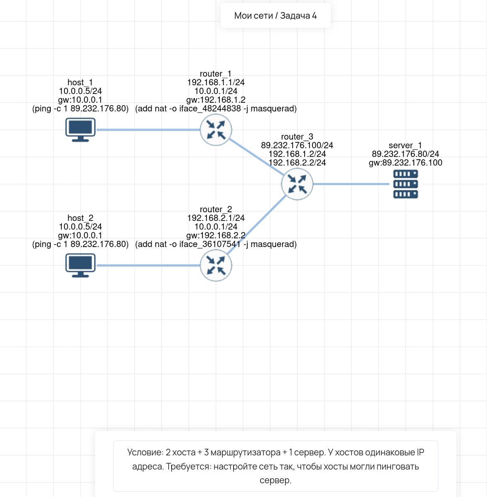

# Lab 04 — NAT и маршрутизация (Одинаковые IP у хостов)

## 🎯 Задача
Настроить сеть из 2 хостов, 3 маршрутизаторов и 1 сервера. У хостов одинаковые IP-адреса (`10.0.0.5/24`). Настроить сеть так, чтобы оба хоста могли пинговать сервер (`89.232.176.80`).

## 🧠 Решение (Логика)
Так как у хостов одинаковые IP-адреса в частной сети, при прохождении через маршрутизаторы возникает конфликт адресов (роутер не понимает, кому возвращать ICMP-ответ). 
**Решение:** На маршрутизаторах, подключенных к хостам (`router_1` и `router_2`), настроен **NAT (Masquerade)**. Он подменяет исходный IP хоста на внешний IP роутера, благодаря чему пакеты не конфликтуют на `router_3`.

## 🛠️ Что сделано:
1.  **host_1 и host_2:** Настроены с IP `10.0.0.5/24`, шлюз `10.0.0.1`.
2.  **router_1 и router_2:** Настроен NAT (masquerade) на интерфейсах, смотрящих в сторону `router_3`.
3.  **router_3:** Выполняет роль центрального маршрутизатора между подсетями.
4.  **server_1:** IP `89.232.176.80/24`, шлюз `89.232.176.100`.
5.  **Проверка:** Выполнен `ping -c 1 89.232.176.80` с обоих хостов. 

## 🔗 Интерактивная схема (Miminet)
[Открыть схему в Miminet](https://miminet.ru/web_network?guid=c709bb16-9f29-46e3-a973-b74ba08835ed)

## 📸 Визуализация
**Схема сети (NAT с одинаковыми IP):**

