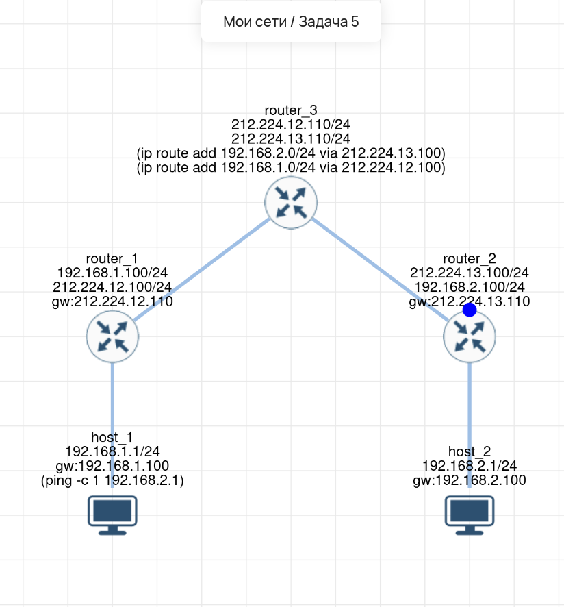

# Lab 05 — Статическая маршрутизация (3 роутера)

## 🎯 Задача
Настроить сеть из двух хостов и трех маршрутизаторов. Хосты находятся в разных подсетях (`192.168.1.0/24` и `192.168.2.0/24`). Настроить сеть так, чтобы `host_1` мог пинговать `host_2`.

## 🧠 Решение (Логика)
Центральный маршрутизатор (`router_3`) по умолчанию знает только сети, подключенные к нему напрямую. Чтобы он мог передавать пакеты от `host_1` к `host_2`, необходимо добавить **статические маршруты**, указывающие, что сети `192.168.1.0/24` и `192.168.2.0/24` доступны через интерфейсы `router_1` и `router_2` соответственно.

## 🛠️ Что сделано:
1.  **host_1 и host_2:** Настроены с IP-адресами и шлюзами по умолчанию (свои роутеры).
2.  **router_1 и router_2:** Настроены с IP-адресами на двух интерфейсах (внутренний и внешний).
3.  **router_3:** Настроены IP-адреса и добавлены статические маршруты:
    *   `ip route add 192.168.2.0/24 via 212.224.13.100`
    *   `ip route add 192.168.1.0/24 via 212.224.12.100`
4.  **Проверка:** Выполнен `ping -c 1 192.168.2.1` с `host_1`.

## 🔗 Интерактивная схема (Miminet)
[Открыть схему в Miminet](https://miminet.ru/web_network?guid=9c82054f-5fdd-476a-850f-122110120533)

## 📸 Визуализация
**Схема сети (статические маршруты):**

