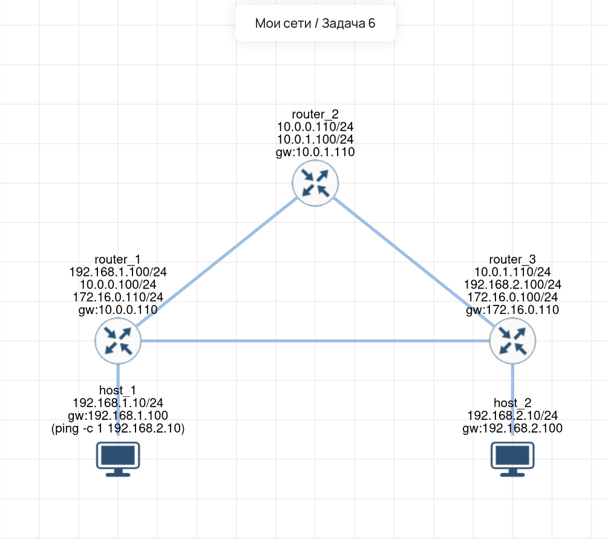

# Lab 06 — Асимметричная маршрутизация

## 🎯 Задача
Настроить сеть из 2 хостов и 3 маршрутизаторов. Маршрутизаторы 1 и 3 соединены напрямую. Требуется настроить сеть так, чтобы пакет от `host_1` до `host_2` проходил по одному пути (через `router_2`), а обратно — по другому (напрямую через `router_1`).

## 🧠 Решение (Логика)
В данной схеме используется **асимметричная маршрутизация**. 
*   На `host_1` шлюзом указан `router_1`, но на самом `router_1` настроен маршрут в сеть `192.168.2.0/24` через `router_2`. 
*   На `host_2` шлюзом указан `router_3`, а на `router_3` настроен маршрут в сеть `192.168.1.0/24` напрямую через `router_1`.
*   Таким образом, трафик «туда» идет длинным путем, а «обратно» — коротким.

## 🛠️ Что сделано:
1.  **host_1:** IP `192.168.1.10/24`, шлюз `192.168.1.100`.
2.  **host_2:** IP `192.168.2.10/24`, шлюз `192.168.2.100`.
3.  **router_1:** Настроены интерфейсы, а также статический маршрут в сеть `192.168.2.0/24` через `router_2`.
4.  **router_3:** Настроены интерфейсы, а также статический маршрут в сеть `192.168.1.0/24` напрямую через `router_1`.
5.  **Проверка:** Выполнен `ping -c 1 192.168.2.10` с `host_1`. Пакеты проходят успешно.

## 🔗 Интерактивная схема (Miminet)
[Открыть схему в Miminet](https://miminet.ru/web_network?guid=9f3195fe-1e4e-49e5-b550-5fd53d0bffa4)

## 📸 Визуализация
**Схема сети (асимметричная маршрутизация):**

