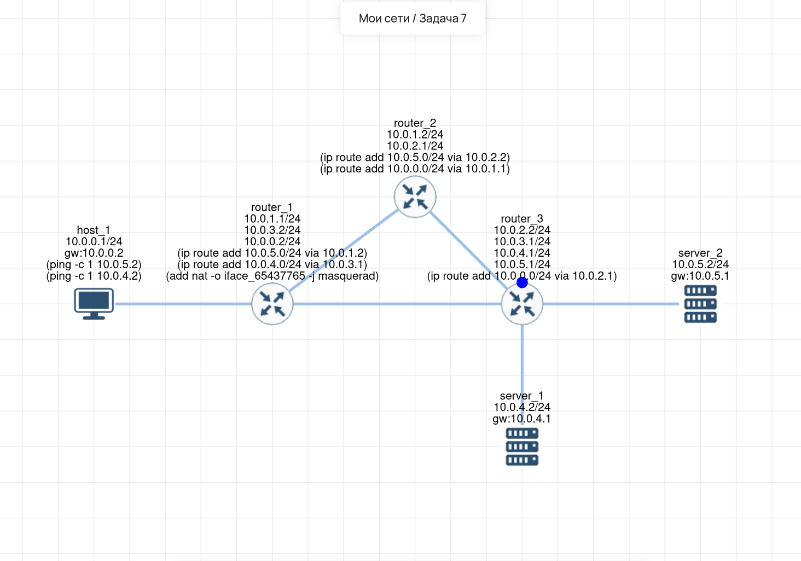

# Lab 07 — Статическая маршрутизация и NAT

## 🎯 Задача
Настроить сеть из 1 хоста, 3 маршрутизаторов и 2 серверов. Требуется обеспечить сетевую связность: 
* `host_1` должен пинговать `server_1` (маршрут через `router_1` и `router_3`).
* `host_1` должен пинговать `server_2` (маршрут через `router_1`, `router_2` и `router_3`).

## 🧠 Решение (Логика)
Для обеспечения связности между разными подсетями настроена статическая маршрутизация на всех роутерах. 
Так как `host_1` находится в изолированной сети, а серверы не имеют маршрутов в его сеть, на `router_1` настроен **Source NAT (MASQUERADE)**. Это подменяет IP-адрес источника на адрес интерфейса роутера, что позволяет ответным пакетам от серверов вернуться обратно.

## 🛠️ Что сделано:
1.  **Включен IP-форвардинг** на всех маршрутизаторах (`sysctl -w net.ipv4.ip_forward=1`).
2.  **router_1:** Настроены статические маршруты до сетей серверов (`10.0.5.0/24` и `10.0.4.0/24`). Настроен NAT (MASQUERADE) для интерфейса, смотрящего в сторону маршрутизаторов.
3.  **router_2:** Настроен маршрут до сети `host_1` (`10.0.0.0/24`) через `router_1`, и до сети `server_2` (`10.0.5.0/24`) через `router_3`.
4.  **router_3:** Настроен маршрут до сети `host_1` (`10.0.0.0/24`). *Примечание: благодаря NAT на router_1, сквозной маршрут до хоста здесь не обязателен, но был прописан для полноты картины.*
5.  **Проверка:** Выполнены команды `ping -c 1 10.0.4.2` и `ping -c 1 10.0.5.2` с `host_1`. Пакеты успешно доходят до обоих серверов.

## 🔗 Интерактивная схема (Miminet)
[Открыть схему в Miminet](https://miminet.ru/web_network?guid=7790474b-21b6-4214-bba9-aeb2a8e2b451)

## 📸 Визуализация
**Схема сети (маршрутизация и NAT):**
 
