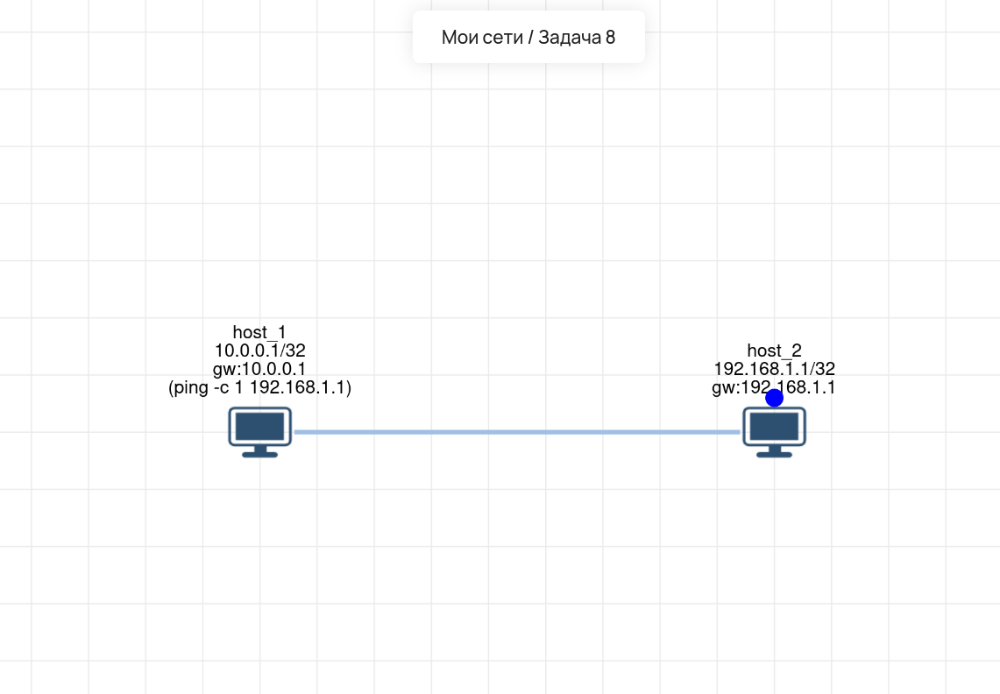

# Lab 08 — Маршрутизация с маской /32 (Point-to-Point)

## 🎯 Задача
Настроить прямое соединение между двумя хостами. Требуется обеспечить связность (`ping`) между `host_1` и `host_2`, используя маску подсети `/32` (точечная адресация).

## 🧠 Решение (Логика)
Маска `/32` означает, что у хоста нет «своей» подсети — он видит только свой собственный IP-адрес. 
Чтобы пакет ушел на другой хост, он должен быть отправлен через **шлюз по умолчанию (Default Gateway)**. 
* На `host_1` шлюзом указан IP `host_2` (`192.168.1.1`).
* На `host_2` шлюзом указан IP `host_1` (`10.0.0.1`).
Благодаря этому пакет от `host_1` инкапсулируется в Ethernet-кадр и отправляется напрямую на MAC-адрес `host_2` (так как они в одном L2-сегменте). 

## 🛠️ Что сделано:
1.  **host_1:** IP `10.0.0.1/32`, шлюз по умолчанию `192.168.1.1`.
2.  **host_2:** IP `192.168.1.1/32`, шлюз по умолчанию `10.0.0.1`.
3.  **Проверка:** Выполнен `ping -c 1 192.168.1.1` с `host_1`. Пакеты проходят успешно.

## 💡 Интересный факт
Маска `/32` часто используется в продакшене для настройки **Loopback-интерфейсов** на роутерах (например, в BGP или OSPF), чтобы создать стабильный IP-адрес устройства, который не зависит от состояния физических портов. Также `/32` используется в облачных сетях (AWS, Azure) для маршрутизации к конкретным балансировщикам или VPN-шлюзам.

## 🔗 Интерактивная схема (Miminet)
[Открыть схему в Miminet](https://miminet.ru/web_network?guid=0e88ec2d-93d5-45eb-a606-d1620f5d2ca2)

## 📸 Визуализация
**Схема сети (маска /32):**

