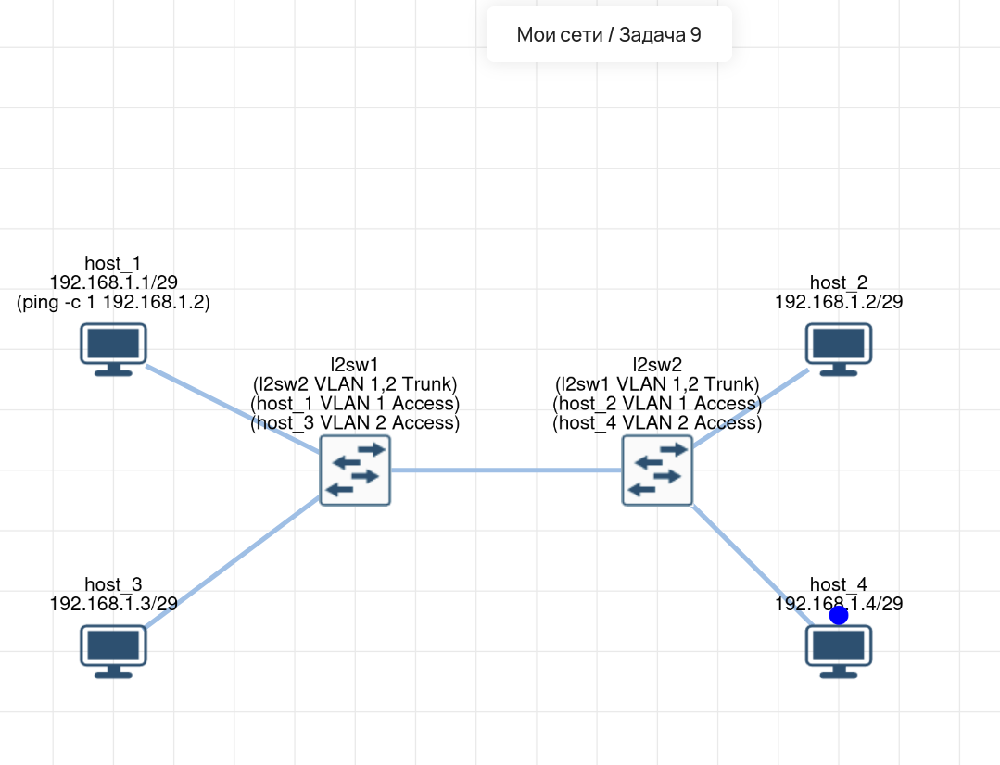

# Lab 09 — VLAN и Trunk-соединение

## 🎯 Задача
Настроить сеть из 4 хостов и 2 коммутаторов. Требуется обеспечить связность между `host_1` и `host_2` (находящимися за разными коммутаторами), но изолировать их широковещательный трафик от `host_3` и `host_4`.

## 🧠 Решение
Для выполнения условия сеть логически разделена с помощью технологии **VLAN**:
* **VLAN 1:** Включает `host_1` и `host_2`.
* **VLAN 2:** Включает `host_3` и `host_4`.
* Порты коммутаторов, к которым подключены хосты, настроены в режиме **Access** (принадлежат только одному VLAN).
* Порт, соединяющий два коммутатора (link между `l2sw1` и `l2sw2`), настроен в режиме **Trunk** (передает тегированный трафик обоих VLAN одновременно).

Благодаря этому `host_1` и `host_2` «видят» друг друга, а трафик `host_3` и `host_4` полностью изолирован.

## 🛠️ Что сделано:
1.  **host_1:** IP `192.168.1.1/29`.
2.  **host_2:** IP `192.168.1.2/29`.
3.  **host_3:** IP `192.168.1.3/29`.
4.  **host_4:** IP `192.168.1.4/29`.
5.  **l2sw1:** Порт к `host_1` переведен в Access VLAN 1. Порт к `host_3` — в Access VLAN 2. Порт к `l2sw2` — в Trunk (разрешен VLAN 1,2).
6.  **l2sw2:** Порт к `host_2` переведен в Access VLAN 1. Порт к `host_4` — в Access VLAN 2. Порт к `l2sw1` — в Trunk (разрешен VLAN 1,2).
7.  **Проверка:** Выполнен `ping -c 1 192.168.1.2` с `host_1`. Успешно. Пинг между `host_1` и `host_3` (или `host_4`) не проходит, что подтверждает изоляцию.

## 💡 Важно
*   **Access-порт** (доступ) — обычно смотрит в сторону конечного устройства (ПК, сервер, принтер). Кадры идут без тега (untagged).
*   **Trunk-порт** (магистраль) — используется для соединения коммутаторов или коммутатора с роутером. Передает кадры с тегами (802.1Q), чтобы принимающая сторона знала, к какому VLAN относится кадр.
*   Хосты физически в одной подсети (`192.168.1.0/29`), но логически разделены на L2-уровне.

## 🔗 Интерактивная схема (Miminet)
[Открыть схему в Miminet](https://miminet.ru/web_network?guid=736e462c-9aa9-45b4-a22c-bf8ea7fed8fc)

## 📸 Визуализация
**Схема сети (VLAN и Trunk):**

