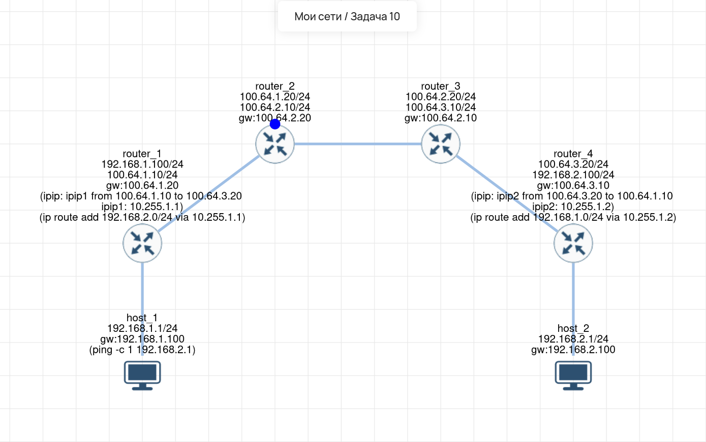

# Lab 10 — Туннелирование (IP-in-IP) и маршрутизация

## 🎯 Задача
Настроить сеть из 2 хостов и 4 маршрутизаторов. Хосты используют приватные (серые) IP-адреса. Маршрутизаторы `router_2` и `router_3` настроены так, что не могут маршрутизировать приватные сети. Требуется обеспечить связность (`ping`) между `host_1` и `host_2`.

## 🧠 Решение 
Так как средние роутеры не пропускают серые адреса, используется технология **IP-in-IP туннелирования**.
1.  На `router_1` и `router_4` создаются виртуальные туннельные интерфейсы (`ipip1` и `ipip2`).
2.  Пакет от `host_1` (адрес `192.168.1.1`) приходит на `router_1`. Тот, согласно маршруту, отправляет его в туннель. Туннель упаковывает этот пакет в новый IP-пакет с белыми адресами: от `100.64.1.10` (router_1) до `100.64.3.20` (router_4).
3.  Роутеры `router_2` и `router_3` видят только белые IP-адреса и спокойно пропускают трафик.
4.  `router_4` получает пакет, распаковывает его из туннеля, видит внутри серый адрес `192.168.2.1` и отдает его `host_2`. Обратный трафик работает аналогично.

## 🛠️ Что сделано:
1.  **host_1:** IP `192.168.1.1/24`, шлюз `192.168.1.100` (router_1).
2.  **host_2:** IP `192.168.2.1/24`, шлюз `192.168.2.100` (router_4).
3.  **router_1:** Создан туннель `ipip1` (Local: `100.64.1.10`, Remote: `100.64.3.20`). IP туннеля: `10.255.1.1/24`. Добавлен маршрут до сети `192.168.2.0/24` через `10.255.1.1`.
4.  **router_4:** Создан туннель `ipip2` (Local: `100.64.3.20`, Remote: `100.64.1.10`). IP туннеля: `10.255.1.2/24`. Добавлен маршрут до сети `192.168.1.0/24` через `10.255.1.2`.
5.  **router_2 и router_3:** Настроены только интерфейсы и базовые маршруты (шлюзы друг на друга). Маршрутов до серых сетей у них нет, и они не нужны.
6.  **Проверка:** Выполнен `ping -c 1 192.168.2.1` с `host_1`. Пакеты проходят успешно через туннель.

## 💡 Важно
*   **Инкапсуляция:** Туннелирование — это по сути «пакет в пакете». Это увеличивает размер пакета (накладные расходы заголовков), но позволяет передавать трафик через недружественные или ограниченные сети (например, через интернет).
*   **IP-in-IP (ipip):** Простой протокол (IP protocol 4), не шифрует данные. Если нужна безопасность — используют IPsec или GRE (Generic Routing Encapsulation), который умеет передавать не только IP, но и multicast/broadcast.
*   **Асимметрия:** В реальных сетях для туннелей часто поднимают IGP (OSPF/BGP) внутри туннеля, чтобы роутеры сами строили маршруты до серых сетей.

## 🔗 Интерактивная схема (Miminet)
[Открыть схему в Miminet](https://miminet.ru/web_network?guid=e9db3f2c-24f3-4c30-84c4-248f09283b78)

## 📸 Визуализация
**Схема сети (IP-in-IP туннель):**

